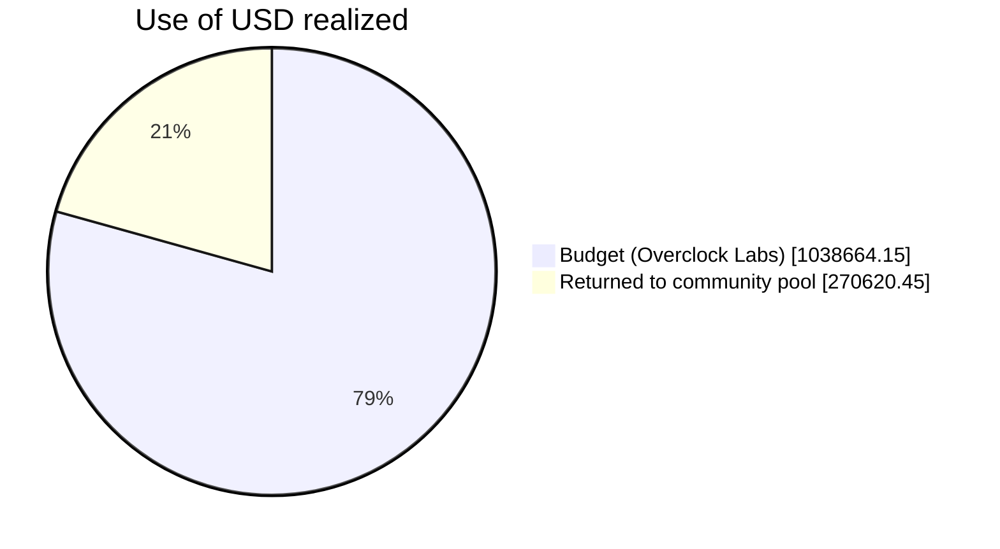
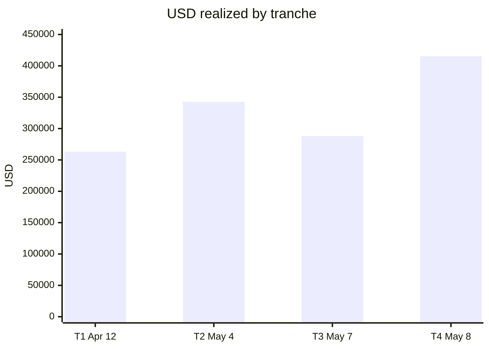

# Q4 2025 / Q1 2026 Funding Proposals Part I: Liquidation Report

| Prop | Proposal | Pass Date | Status |
| --- | --- | --- | --- |
| [319](https://www.mintscan.io/akash/proposals/319) | Core Engineering Q4 2025 / Q1 2026 Funding Proposal Part I | March 26 2026 | Complete |
| [320](https://www.mintscan.io/akash/proposals/320) | Client Engineering Q4 2025 / Q1 2026 Funding Proposal Part I | March 26 2026 | Complete |
| [321](https://www.mintscan.io/akash/proposals/321) | AEP Support Services Q4 2025 / Q1 2026 Funding Proposal Part I | March 26 2026 | Complete |

Report date: November 20 2026

## Summary

The three proposals requested $1,038,664.15 in budget plus a 25% AKT volatility buffer of $259,666.04, for a total of $1,298,330.19, sized at a reference price of $0.50 per AKT. The community pool sent 2,596,660 AKT.

All AKT was sold between April 1 and May 8 2026 for $1,309,284.60. Overclock Labs kept the budget of $1,038,664.15. The remaining $270,620.45 was used to buy back 327,306 AKT, which was returned to the community pool on June 11 2026.

## 1. Funding received

Paid from the community pool by `MsgCommunityPoolSpend` when each proposal passed, to `akash1znczdpwvdnyt4szde5yyanhm9xp5jcgdl67tnx`.

| Prop | Budget (USD) | Volatility buffer 25% (USD) | Total request (USD) | AKT received |
| --- | --- | --- | --- | --- |
| 319 | 324,276.03 | 81,069.01 | 405,345.04 | 810,690 |
| 320 | 230,120.83 | 57,530.21 | 287,651.04 | 575,302 |
| 321 | 484,267.29 | 121,066.82 | 605,334.11 | 1,210,668 |
| **Total** | **1,038,664.15** | **259,666.04** | **1,298,330.19** | **2,596,660** |

## 2. Liquidations

Liquidation window: April 1 2026 to May 8 2026.

The AKT was sold in four tranches.

| Tranche | Settled | AKT sold | USD realized | Avg price (USD per AKT) |
| --- | --- | --- | --- | --- |
| 1 | 2026-04-12 | 564,487.76 | 263,220.00 | 0.466299 |
| 2 | 2026-05-04 | 725,026.81 | 342,687.35 | 0.472655 |
| 3 | 2026-05-07 | 582,119.63 | 288,038.80 | 0.494810 |
| 4 | 2026-05-08 | 725,027.00 | 415,338.45 | 0.572859 |
| Rounding | | (1.20) | | |
| **Total** | | **2,596,660.00** | **1,309,284.60** | **0.504219** |

### By proposal

Each tranche is split across the three proposals by their share of the AKT received.

| Prop | AKT sold | USD realized | Budget | Excess over budget |
| --- | --- | --- | --- | --- |
| 319 | 810,690 | 408,765.08 | 324,276.03 | 84,489.05 |
| 320 | 575,302 | 290,078.04 | 230,120.83 | 59,957.21 |
| 321 | 1,210,668 | 610,441.48 | 484,267.29 | 126,174.19 |
| **Total** | **2,596,660** | **1,309,284.60** | **1,038,664.15** | **270,620.45** |

## 3. Returned to the community pool

The $270,620.45 realized above budget was used to buy back AKT on June 2 and June 11 2026 for a total cost of $270,617.81. The 327,306 AKT bought back was returned to the community pool with `MsgFundCommunityPool`.

| Date | AKT returned | USD value | Tx |
| --- | --- | --- | --- |
| 2026-06-11 | 327,306 | 270,617.81 | [349A482E...](https://www.mintscan.io/akash/tx/349A482E8ACBEF02E2A40EEAFEC6226EE64712FDC2D079DF2ECC1412AAE5637E) |

## 4. Final position

| Line | USD |
| --- | --- |
| USD realized | 1,309,284.60 |
| Less budget kept by Overclock Labs | (1,038,664.15) |
| Less buyback cost of AKT returned to the community pool | (270,617.81) |
| Rounding | (2.64) |
| **Remaining** | **0.00** |

No AKT from these proposals remains unsold or held.
