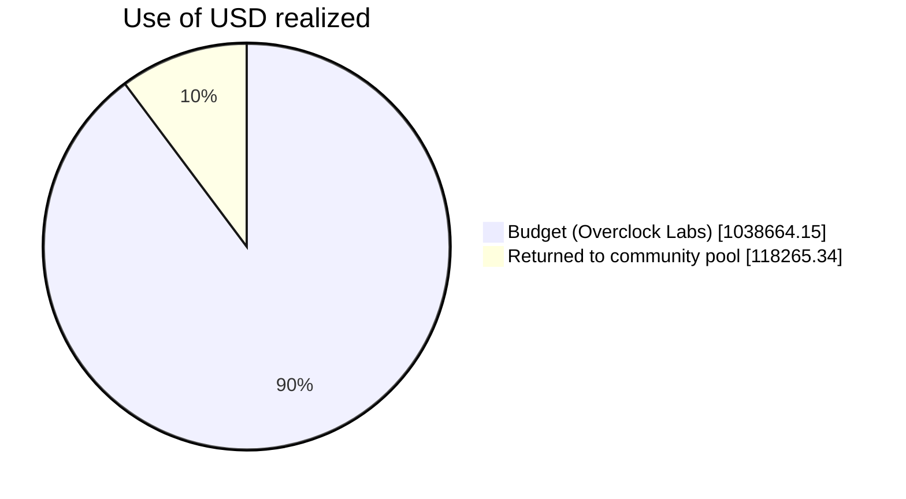
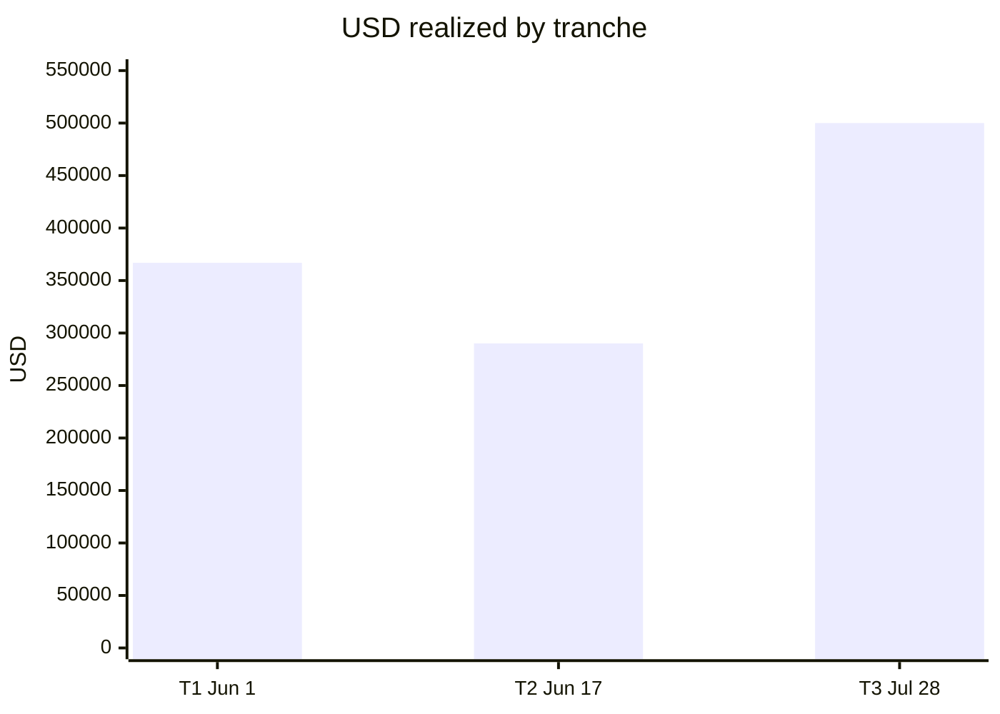

# Q4 2025 / Q1 2026 Funding Proposals Part II: Liquidation Report

| Prop | Proposal | Pass Date | Status |
| --- | --- | --- | --- |
| [323](https://www.mintscan.io/akash/proposals/323) | Core Engineering Q4 2025 / Q1 2026 Funding Proposal Part II | May 18 2026 | Complete |
| [324](https://www.mintscan.io/akash/proposals/324) | Client Engineering Q4 2025 / Q1 2026 Funding Proposal Part II | May 18 2026 | Complete |
| [325](https://www.mintscan.io/akash/proposals/325) | AEP Support Services Q4 2025 / Q1 2026 Funding Proposal Part II | May 18 2026 | Complete |

Report date: November 20 2026

## Summary

The three proposals requested $1,038,664.15 in budget plus a 49.80% AKT volatility buffer of $517,258.24, for a total of $1,555,922.39, sized at a reference price of about $0.86 per AKT. The community pool sent 1,814,275.58 AKT.

All AKT was sold between May 19 and July 28 2026 for $1,156,929.49. Overclock Labs kept the budget of $1,038,664.15. The remaining $118,265.34 was used to buy back 208,938.18 AKT, which was returned to the community pool on August 26 2026.

## 1. Funding received

Paid from the community pool by `MsgCommunityPoolSpend` when each proposal passed, to `akash1znczdpwvdnyt4szde5yyanhm9xp5jcgdl67tnx`.

| Prop | Budget (USD) | Volatility buffer 49.80% (USD) | Total request (USD) | AKT received |
| --- | --- | --- | --- | --- |
| 323 | 324,276.03 | 161,490.55 | 485,766.58 | 566,425.58 |
| 324 | 230,120.83 | 114,600.95 | 344,721.78 | 401,961.00 |
| 325 | 484,267.29 | 241,166.74 | 725,434.03 | 845,889.00 |
| **Total** | **1,038,664.15** | **517,258.24** | **1,555,922.39** | **1,814,275.58** |

## 2. Liquidations

Liquidation window: May 19 2026 to July 28 2026.

The AKT was sold in three tranches.

| Tranche | Settled | AKT sold | USD realized | Avg price (USD per AKT) |
| --- | --- | --- | --- | --- |
| 1 | 2026-06-01 | 453,568.75 | 366,890.59 | 0.808897 |
| 2 | 2026-06-17 | 453,568.75 | 290,052.84 | 0.639490 |
| 3 | 2026-07-28 | 907,138.00 | 499,986.06 | 0.551169 |
| Rounding | | 0.08 | | |
| **Total** | | **1,814,275.58** | **1,156,929.49** | **0.637681** |

### By proposal

Each tranche is split across the three proposals by their share of the AKT received.

| Prop | AKT sold | USD realized | Budget | Excess over budget |
| --- | --- | --- | --- | --- |
| 323 | 566,425.58 | 361,198.96 | 324,276.03 | 36,922.93 |
| 324 | 401,961.00 | 256,322.99 | 230,120.83 | 26,202.16 |
| 325 | 845,889.00 | 539,407.54 | 484,267.29 | 55,140.25 |
| **Total** | **1,814,275.58** | **1,156,929.49** | **1,038,664.15** | **118,265.34** |

## 3. Returned to the community pool

The $118,265.34 realized above budget was used to buy back AKT on August 26 2026 for a total cost of $118,265. The 208,938.18 AKT bought back was returned to the community pool with `MsgFundCommunityPool`.

| Date | AKT returned | USD value | Tx |
| --- | --- | --- | --- |
| 2026-08-26 | 208,938.18 | 118,265.00 | [07147700...](https://www.mintscan.io/akash/tx/071477006C75AEA4B6BC4A2BC5EBA4B063F406D106E846DA222F11FE86CD23C9) |

## 4. Final position

| Line | USD |
| --- | --- |
| USD realized | 1,156,929.49 |
| Less budget kept by Overclock Labs | (1,038,664.15) |
| Less buyback cost of AKT returned to the community pool | (118,265.00) |
| Rounding | (0.34) |
| **Remaining** | **0.00** |

No AKT from these proposals remains unsold or held.
