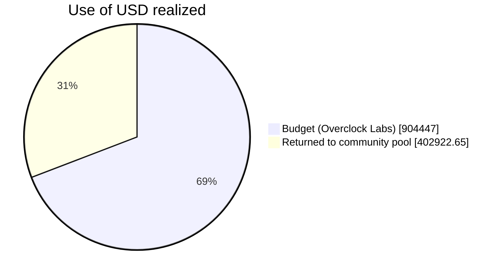
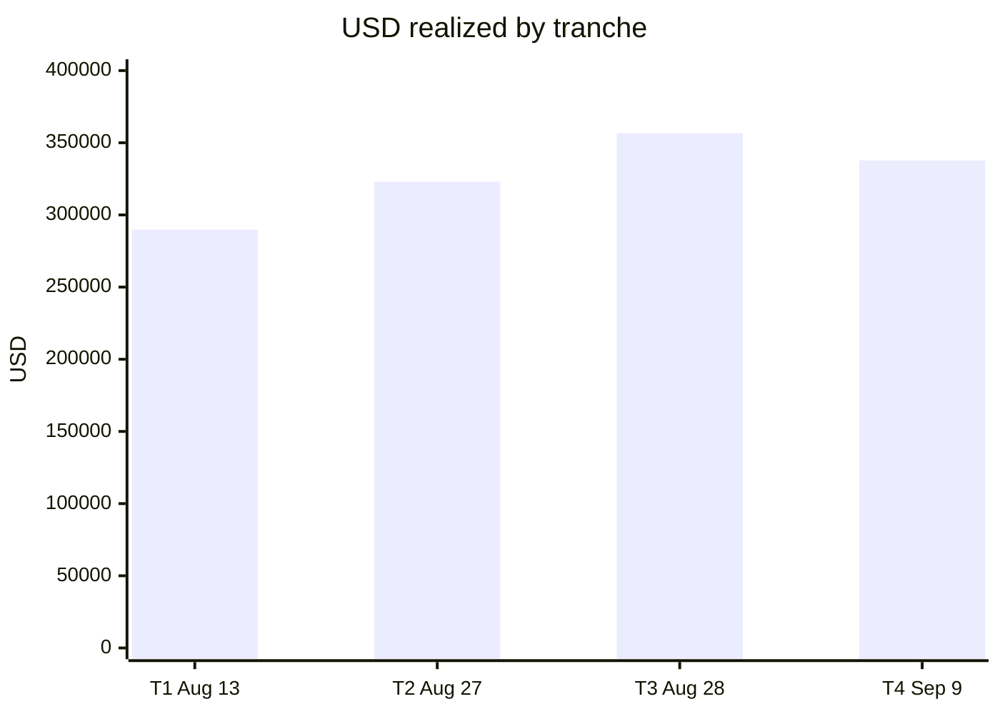

# Q2 2026 Funding Proposals: Liquidation Report

| Prop | Proposal | Pass Date | Status |
| --- | --- | --- | --- |
| [331](https://www.mintscan.io/akash/proposals/331) | AEP Support Services – Q2 2026 Funding Proposal | July 30 2026 | Complete |
| [332](https://www.mintscan.io/akash/proposals/332) | Client Engineering – Q2 2026 Funding Proposal | July 30 2026 | Complete |
| [333](https://www.mintscan.io/akash/proposals/333) | Core Engineering – Q2 2026 Funding Proposal | July 30 2026 | Complete |

Report date: November 20 2026

## Summary

The three proposals requested $904,447 in budget plus a 44.7% AKT volatility buffer of $404,288, for a total of $1,308,735, sized at a reference price of $0.5181 per AKT. The community pool sent 2,526,027.80 AKT.

All AKT was sold between July 31 and September 9 2026 for $1,307,369.65. Overclock Labs kept the budget of $904,447. The remaining $402,922.65 was used to buy back 567,146.34 AKT, which was returned to the community pool on October 28 2026.

## 1. Funding received

Paid from the community pool by `MsgCommunityPoolSpend` when each proposal passed.

| Prop | Recipient | Budget (USD) | Volatility buffer 44.7% (USD) | Total request (USD) | AKT received |
| --- | --- | --- | --- | --- | --- |
| 331 | `akash1km3d5nejpz9f4akle4k40lgejtzk25r8wx2kca` | 428,709.00 | 191,633.00 | 620,342.00 | 1,197,340.28 |
| 332 | `akash1kfu3ar4pl2urpx7h6cewdr2r38yp0wtk3q47nc` | 273,540.00 | 122,272.00 | 395,812.00 | 763,968.35 |
| 333 | `akash1frnzw5xufsd309nmdtdufupldpp252typgfwse` | 202,198.00 | 90,383.00 | 292,581.00 | 564,719.17 |
| **Total** | | **904,447.00** | **404,288.00** | **1,308,735.00** | **2,526,027.80** |

## 2. Liquidations

Liquidation window: July 31 2026 to September 9 2026.

The AKT was sold in four tranches.

| Tranche | Settled | AKT sold | USD realized | Avg price (USD per AKT) |
| --- | --- | --- | --- | --- |
| 1 | 2026-08-13 | 590,399.20 | 289,827.57 | 0.490901 |
| 2 | 2026-08-27 | 631,506.95 | 323,049.05 | 0.511553 |
| 3 | 2026-08-28 | 672,614.70 | 356,687.32 | 0.530300 |
| 4 | 2026-09-09 | 631,506.95 | 337,805.71 | 0.534920 |
| **Total** | | **2,526,027.80** | **1,307,369.65** | **0.517559** |

### By proposal

Each tranche is split across the three proposals by their share of the AKT received.

| Prop | AKT sold | USD realized | Budget | Excess over budget |
| --- | --- | --- | --- | --- |
| 331 | 1,197,340.28 | 619,694.82 | 428,709.00 | 190,985.82 |
| 332 | 763,968.35 | 395,399.07 | 273,540.00 | 121,859.07 |
| 333 | 564,719.17 | 292,275.76 | 202,198.00 | 90,077.76 |
| **Total** | **2,526,027.80** | **1,307,369.65** | **904,447.00** | **402,922.65** |

## 3. Returned to the community pool

The $402,922.65 realized above budget was used to buy back AKT on October 25 2026 for a total cost of $402,923.16. The 567,146.34 AKT bought back was returned to the community pool with `MsgFundCommunityPool`.

| Date | AKT returned | USD value | Tx |
| --- | --- | --- | --- |
| 2026-10-28 | 567,146.34 | 402,923.16 | [70031803...](https://www.mintscan.io/akash/tx/70031803533374895800CE006E372BE21799C2A0A9808E7513C53F5544607110) |

## 4. Final position

| Line | USD |
| --- | --- |
| USD realized | 1,307,369.65 |
| Less budget kept by Overclock Labs | (904,447.00) |
| Less buyback cost of AKT returned to the community pool | (402,923.16) |
| Rounding | 0.51 |
| **Remaining** | **0.00** |

No AKT from these proposals remains unsold or held.
